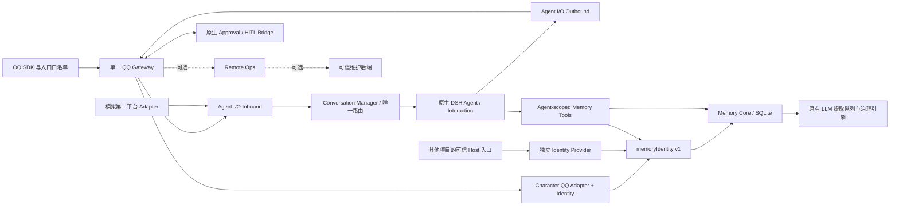

# 运行架构与复用边界

当前源码接口说明；安装与恢复见 INTEGRATION，验证边界见 STATUS。

当前外部通信主链：QQ SDK 的真实连接与准入 → Agent I/O 可信 Inbound（platform / adapter / account / Conversation 去重）→ Conversation Manager 唯一当前路由 → 原生 Agent / 可选 Interaction → Agent I/O 队列 → QQ Adapter 的分片、限额及平台 API。Web/Desktop 继续使用原生窗口通道。

| 出口 | 发送权威与调用链 |
|---|---|
| 普通正文、Interaction 气泡/等待/工具错误 | 原生事件/Interaction 提交完整逻辑消息 → `sendMessage` → QQ 文本 Adapter；同一逻辑 ID 不重复交出 |
| Commands 与会话获取失败提示 | 已认领/验证的入站对象 → `conversation.reply` 的短期输入回复授权 → 同一 I/O；不需要新建 Session，不授予 Memory 或通知权限 |
| 审批、问答 | 原生 Approval/userQuestions 唯一结算 → 可选 HITL Bridge → 同一 I/O；QQ 只渲染/解码按钮 |
| Schedule、Long Tasks、维护通知 | Character Outbox 唯一持久交出者 → `openNotifications` → 同一 I/O；独立 QQ 的 Remote Ops 使用其 JSON Ledger，二者不同时发送同一事件 |
| Media | 路径授权与资源校验 → I/O 附件 → QQ Adapter → 上传及媒体消息 API；上传成功不是消息送达 |
| Typing、WebSocket/Token、交互 ACK | QQ 协议控制操作，留在平台 Adapter；ACK 不结算或批准原生请求 |

所有 I/O 目标新增显式 `adapter`；这是进程内身份范围补全，不重算持久 ID。旧的低层 `sendMessage/registerAdapter` 调用可在独立 `legacy` 范围配对使用；不能借缺少 adapter 的请求进入具名平台通道。排队任务绑定注册时的 Adapter 实例，HMR/撤权后不会接管新实例继续发送。

Character Adapter 通过 QQ 自有入口的 Host-only `integration.qqGatewayLifecycle@1` 参数挂接 Identity（`lifecycle.mjs`），不再修改 Remote Ops 的 `attach`。它必须在 SDK 启动前完成绑定；不依赖同一 Cordis apply 中刚提供的服务立即可见。普通 QQ 不需要这个参数或 Character。Identity 保留 Manager 生命周期包装，使用公开 records/current/ownership 契约；当前授权还复核 Gateway Owner 策略、真实当前 record 与 Context 活性。原始 Memory 证据从 I/O 去重后的输入钩子进入，不再向 SDK Bot 插入 Character 中间件；platformData、昵称、群 Conversation 和模型参数不颁发能力。

| 持久状态 | 唯一写入者 |
|---|---|
| Conversation Session/模型/Preset/轮换偏好 | Conversation Manager 的共享 PrefsStore；Identity routes 只是历史证据 |
| Session 历史、Compaction、Schedule | 原生 DSH Session/Persistence/Schedule |
| qq_bindings、历史 routes、身份 scope | Character Identity；不把历史绑定恢复为完整 Owner 权限 |
| Character 通知 Outbox 与来源 | `character-identity/outbox.mjs`；Remote Ops 只委托并记录交接摘要 |
| 独立 Remote Ops 的通知 JSON Ledger | Remote Ops；不能作为 Character Outbox 的第二个发送者 |
| Memory/修订/治理/L1-L3 | Memory Core；Inspector 和 Tools 都调用 Core |
| 长任务 task/run 记录 | Long Tasks 的原生 storageDomain；调度仍由原生 Schedule 执行 |

诊断为可选、进程内有界观察，规范见 QQTK 的 `docs/DIAGNOSTICS.md`。同一 I/O 实例共享 HMAC 关联，原始身份/正文/凭据不进入事件；观察异常不改变授权或发送结果。SDK 默认错误中间件的直发异常路径已移除：进入 I/O 前的异常只记录固定 Host 提示，不能在没有输入授权时恢复旧 Sender 回退。

Identity 通过公开 `records / ownershipState / isCurrentSession` 契约绑定真实 Agent，SQLite routes 仅保留历史证据，不再作为当前主路由权威。Owner、项目/角色和 Memory capability 仍由 Identity 授权；Manager 不发放权限。平台 pending approval/question、额外 prompt 和 Typing 清理通过 Adapter 回调提供。

rc.3 的 Character Spawn 通过既有 Tools 包内的轻量适配转调原生实现：仅为组件重载时的注册表扫描过滤已关闭 Context，保留原生配置与授权。它不改变 Conversation Manager 的销毁顺序、不修改官方模块，也不增加 Agent Manager。确定性复现与移除条件见 [Worker 文档](WORKERS.md#rc3-销毁与热重载适配)。

Worker V2 使用官方 `subagent` 的 `agentPreset / allowedAgentPresets` 和 `spawn`。Core 声明 general、explore、librarian、oracle、metis、momus、planner；review 仍可选，社区引用经可信构建配置审查。Character 唯一 Root 保留完整 Creator，按需向 Planner 请求草案；Worker 是独立 Preset，工具/Skills 按原生 Scope 装配，不继承 QQ/Memory 或父历史，`maxDepth:1`。角色/白名单/Root 策略共用词表；Worker Preset 用原生 restrict/guard 屏蔽只读搜索以外的 Host 全局工具（见 WORKERS），不增加 Manager、Spawn Provider 或 Agent Loop；隔离验收及部署边界见 STATUS。Inspector 是额外可选双端插件：原生 `dsh.client` 将 React 页面注册到 `settings.section`，复用 DSH 导航、组件与主题；通过 Connection RPC 与受控 Core API 访问记忆。四个核心插件与可选 Extras 边界保持；详见 [Worker](WORKERS.md) 和 [Inspector](MEMORY-INSPECTOR.md)。

| 组件 | 之前 | 现在 |
|---|---|---|
| 版本化 QQ 基础适配 | `agents + qqRemoteOps` 必需 | `agents + conversationManager`；原生 `agentPresets` 组合会话；Remote Ops 可选 |
| Remote Ops | 显式安装根目录下的私人维护脚本 | 独立状态目录和 Owner；可选 Host `qqMaintenance` 后端；兼容旧 root 后端 |
| Memory Core | `characterIdentity` | 标准 `memoryIdentity@1`、DSH LLM/Agent/默认模型；不导入 QQ/Character |
| Memory Tools 默认入口 | Character 身份、提示词、通知查询 | `memoryIdentity@1 + dshMemory + tools + systemPrompt`，Agent-scoped |
| Tools `character.mjs` | 无独立边界 | 同包内专用入口：旧工具名、Character 提示、QQ 通知查询 |
| Character Identity | QQ Owner、会话绑定、通知账本 | 原有职责 + 标准可信身份适配、QQ 全消息确认策略；通知 Outbox（`outbox.mjs`，唯一写入者）经 Agent I/O 通知器发送 |
| Character QQ Adapter | 包装 Remote Ops attach | Host-only 生命周期参数；只允许配置的 Character Preset，不接受解析失败降级 |
| Definition / Creator 派生 | 固定默认路径和 Preset | 角色路径、Preset ID、数据目录可配置；官方 Creator 指纹变更触发重建 |

## 数据流

图中 CI 和 LI 是替代配置，单个作用域只装配一个 Provider。其他项目不需要安装 Character Identity、QQ Adapter 或两个 Character Bundle。

Inspector 可以直接依赖 Core 的管理 API；Core 不反向依赖 Inspector，不新增接口服务。Character Adapter 对 Identity、Memory 的组合依赖是项目边界，不要求 Remote Ops；基础 QQ 或通用 Memory 也不要求安装这些 Character 组件。旧 Worker 模块仅保留无操作兼容入口，新 Preset 不引用它。

v0.7.8 主体目标已有实现，但项目范围仍由可信 binding 固定；尚无任务级 grants 或项目管理 UI。主路由/生命周期现由独立 Manager 管理，稳定通知目的地和 Outbox 仍在 Identity。原生 Schedule 固定原 Session，经持久 qq_bindings 冷恢复原根，不迁移提醒；长期任务仍使用原生 storageDomain 和独立任务根。旧 Task Memory 只有只读预览，正式导入未开发。

后续 NapCat/OneBot Adapter 可复用 Manager，只负责协议、可信入站/发送和审批展示；当前没有 NapCat 连接器。跨平台账号关联、多用户/群聊策略、Approval/Notification Router 尚未实现。未来审批必须沿用唯一原生 Approval，Identity 验证审批人，Router 选渠道；通知使用稳定 Conversation 目的地，不能绑定临时 msgId。namespace 不自动代表身份或跨平台共享权限。

## 可信契约

Host 服务 `memoryIdentity`：

- `contractVersion: 1`。
- `forSession(sessionId)`：查询真实 Host Agent/Session，返回不可伪造、可撤销的句柄。不得把模型提供的 principal/project/namespace 直接包装成权限。
- `authorize(handle, 'read'|'write')`：验证句柄仍有效，返回 `{principalId, namespaceId, projectId}`。
- `current([principalId, namespaceId, projectId])`：只返回同作用域的可用 Session，供中断提取任务恢复；不得跨项目退回默认用户。
- `onEvidence(listener)`：订阅可信入口证据，返回卸载函数。事件是 `(handle, {sessionId, eventSeq, origin, messageId, text, receivedAt})`。真实用户原文使用 `direct_user`；模型记忆工具只产生 `inference`。工具输出不可冒充用户。
- 可选 `confirmationEvidence(handle, {memory, quote})`：Host 核对真实、近期的完整确认输入，返回来源。未提供时 confirm 工具拒绝执行，不静默确认。

Core 提供 `dshMemory`，保留 `characterMemory` 服务别名。SQLite 原有 `character` 列承载通用 namespace；旧 Character scope 值保持不变。test.8 的部署记录已确认生产迁移到 Schema 3；本次审计修复没有访问生产库，也没有再次部署。可选 Host 字段 `agentId`、`memoryMode`、`l3Tokens` 控制人格化与投影；模型不能填写这些权限字段。

当前源码的读取先验证 Host、Agent 和形成模式，再排除退休证据，汇合可见用途做相关性排序与预算。冲突检查只在当前可见集合内进行，避免暴露另一 Agent 的私有条目。新形成的人格化来源带 `memoryPolicy`；Assistant 不读取 Character 或缺少模式标记的历史人格化记录。详细兼容边界见 STATUS。

身份句柄只在当前进程有效，Session 恢复后重新由 Host 确认。示例 Provider 用实际 Agent 对象、挂载的 Preset 和 WeakSet 颁发/验证句柄。它用于可信单用户本机入口，不是互联网登录或多租户认证系统。能够加载任意 Host 插件的代码属于可信计算基，插件同进程执行不构成恶意代码沙箱。

存量审计只读原生 `schedule.catalog()` 与 `sessionPersistence.stat()`；仅从固定作用域的 `routes/qq_bindings`、QQ prefs 当前/previousSessionId 出发，沿原生持久 `parentSession` 向祖先查证，并核对 Preset 与非委派根。Preset/cwd/消息正文相同都不能单独证明归属。启动/冷恢复可事务补齐已核实的**提醒绑定**，不修改主路由、Schedule 或 Memory；并发证据变化拒绝补写。归属不明的冷恢复在原生投递确认前拒绝，保留任务；已存活的未绑定根在原生 `followup` 接入前拒绝 Schedule，避免消费 occurrence，工具及模型也被拒绝。重载扫描已有 Character 根，实际 Agent 上的门禁动态查询新 Provider；不增加 inbox、调度器或权限存储。此处不替代有权加载任意 Host 插件的可信计算基。

DSH 0.2.2 的 Schedule 目录项以 `target` 表示投递目标：只有 `{kind:'session'}` 的固定 Session 进入上述归属链审计；`new_once`/`new` 或缺少目标的行一律记为 `untrusted_target`，不从 Session ID、Preset 或记录推定 Owner。0.2.2 的 `schedule_*` 模型工具改为 Host 范围，Owner 根上限定为 Owner 自己的提醒：`schedule_create` 只能 `target:this_session`；`schedule_view`/`schedule_edit` 只能操作固定投递到调用 Session，或投递到持有持久提醒绑定（`qq_bindings`，与提醒送达使用同一证据）的早先 Owner Session 的任务，改投只能是 `this_session`。Long Task 根、角色/其他主体与未证明归属的 Session 一律拒绝。准入守卫（同步）只检查参数；归属在原生工具体运行前的 `tools/execute` 环节，用新鲜的原生 `view()` 判定，修改再以该修订号钉住原生 `expectedUpdatedAt` CAS，因此不依赖缓存，也不会因并发改投而写到别人的任务上。视图失败、服务缺失或调用方已被轮换下线时拒绝。`schedule_list` 仍是同一 Owner 的 Host 范围只读列表。0.2.2 新增的 `[SCHEDULE CHANGE]` 管理通知不是到期提醒，不进入 Outbox。

可选角色模式（I1/I2）：QQTK Identity & Access 是 Agent I/O 与 Conversation Manager 之间的第二道闸门，决定 Principal、角色与可撤销授权；Character Identity 只对 Owner 绑定身份、Memory、提醒与 Outbox，对其他角色仅放行其角色 Preset Session。细节见 [Identity & Access](IDENTITY-ACCESS.md)。

## 生命周期与单例

- QQ 接入、问答与审批只由基础 Gateway 建立。Core 的 Adapter 调用该 Gateway；Extras 不包含 QQ 条目。Preset 不创建连接。
- 维护补丁在进程级共享注册表中按 QQ appId 占用租约；重复模块副本也拒绝重复启动。卸载先停止 SDK/Session，再释放租约。
- 多进程不能靠内存租约互斥；部署脚本用维护锁和单活检查隔离真实 QQ 验证与生产。
- 上游 QQ 用户目录偏好会跨 Profile 共用；维护补丁优先使用 DSH_HOME/qqbot。不同项目必须分开 DSH_HOME；无环境配置时保留旧路径，不自动迁移或覆盖旧数据。
- Remote Ops 在 Gateway 引导时可选绑定。运行中新增/移除它应重载 Gateway 或重启 Profile；暂不支持无重载的动态能力发现。
- Character Adapter 保留 QQTK 通知到 Character outbox 的桥接，卸载撤销身份。Outbox 只经 Gateway 交来的 Agent I/O 通知器发送（稳定 Owner 目标，不要求当前 Session；每个分片前复核 Gateway 附加、Owner-only 策略与提醒来源 Session 的绑定证据），没有通知器时保持待发。失效 Preset 拒绝服务，不能退回权限不同的宿主组合。

## 明确未改变的部分

保留既有三类记忆、FTS5、CAS、近重复处理、时效、来源、遗忘防复活和提取队列。test.8 已新增 L1、跨事件 L2 巩固、L3 摘录投影及话题消费策略；不追溯改变 test.7 交付声明。test.12 增加受限分析 Worker，没有主动闲聊。冲突的完整语义判断、网络投递 exactly-once、提醒目标迁移与跨机器认证仍不是已完成能力；test.13 的可选 QQ 轮换已隔离验证并在本机启用，实际收件待验收。
