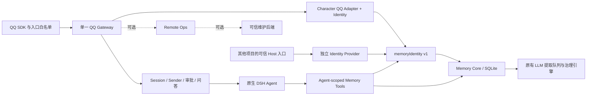

# 运行架构与复用边界（test.7）

这是实现说明，不代表未来长期记忆设计已经实现。四个 Character 运行时包保留；Definition 是构建模块，Core/Extras 是项目 Bundle。

| 组件 | 之前 | 现在 |
|---|---|---|
| 版本化 QQ 基础适配 | `agents + qqRemoteOps` 必需 | `agents` 必需；原生 `agentPresets` 用于会话组合；Remote Ops 可不安装 |
| Remote Ops | 显式安装根目录下的私人维护脚本 | 独立状态目录和 Owner；可选 Host `qqMaintenance` 后端；兼容旧 root 后端 |
| Memory Core | `characterIdentity` | 标准 `memoryIdentity@1`、DSH LLM/Agent/默认模型；不导入 QQ/Character |
| Memory Tools 默认入口 | Character 身份、提示词、通知查询 | `memoryIdentity@1 + dshMemory + tools + systemPrompt`，Agent-scoped |
| Tools `character.mjs` | 无独立边界 | 同包内专用入口：旧工具名、Character 提示、QQ 通知查询 |
| Character Identity | QQ Owner、会话绑定、通知账本 | 原有职责 + 标准可信身份适配、QQ 全消息确认策略 |
| Character QQ Adapter | QQTK attach 拦截 | 保留；只允许配置的 Character Preset，不接受解析失败降级 |
| Definition / Creator 派生 | 固定默认路径和 Preset | 角色路径、Preset ID、数据目录可配置；官方 Creator 指纹变更触发重建 |

## 数据流

图中 CI 和 LI 是替代配置，单个作用域只装配一个 Provider。其他项目不需要安装 Character Identity、QQ Adapter 或两个 Character Bundle。

## 可信契约

Host 服务 `memoryIdentity`：

- `contractVersion: 1`。
- `forSession(sessionId)`：查询真实 Host Agent/Session，返回不可伪造、可撤销的句柄。不得把模型提供的 principal/project/namespace 直接包装成权限。
- `authorize(handle, 'read'|'write')`：验证句柄仍有效，返回 `{principalId, namespaceId, projectId}`。
- `current([principalId, namespaceId, projectId])`：只返回同作用域的可用 Session，供中断提取任务恢复；不得跨项目退回默认用户。
- `onEvidence(listener)`：订阅可信入口证据，返回卸载函数。事件是 `(handle, {sessionId, eventSeq, origin, messageId, text, receivedAt})`。真实用户原文使用 `direct_user`；模型记忆工具只产生 `inference`。工具输出不可冒充用户。
- 可选 `confirmationEvidence(handle, {memory, quote})`：Host 核对真实、近期的完整确认输入，返回来源。未提供时 confirm 工具拒绝执行，不静默确认。

Core 提供 `dshMemory`，保留 `characterMemory` 服务别名。SQLite 原有 `character` 列承载通用 namespace；旧 Character scope 值保持不变，Schema 仍为 2，没有搬迁或重建生产数据库。

身份句柄只在当前进程有效，Session 恢复后重新由 Host 确认。示例 Provider 用实际 Agent 对象、挂载的 Preset 和 WeakSet 颁发/验证句柄。它用于可信单用户本机入口，不是互联网登录或多租户认证系统。能够加载任意 Host 插件的代码属于可信计算基，插件同进程执行不构成恶意代码沙箱。

## 生命周期与单例

- QQ 接入、问答与审批只由基础 Gateway 建立。Core 的 Adapter 调用该 Gateway；Extras 不包含 QQ 条目。Preset 不创建连接。
- 维护补丁在进程级共享注册表中按 QQ appId 占用租约；重复模块副本也拒绝重复启动。卸载先停止 SDK/Session，再释放租约。
- 多进程不能靠内存租约互斥；部署脚本用维护锁和单活检查隔离真实 QQ 验证与生产。
- 上游 QQ 用户目录偏好会跨 Profile 共用；维护补丁优先使用 DSH_HOME/qqbot。不同项目必须分开 DSH_HOME；无环境配置时保留旧路径，不自动迁移或覆盖旧数据。
- Remote Ops 在 Gateway 引导时可选绑定。运行中新增/移除它应重载 Gateway 或重启 Profile；暂不支持无重载的动态能力发现。
- Character Adapter 保留 QQTK 通知到 Character outbox 的桥接，卸载撤销身份。失效 Preset 拒绝服务，不能退回权限不同的宿主组合。

## 明确未改变的部分

保留既有三类记忆、FTS5、CAS、近重复处理、时效、来源、遗忘防复活和提取队列。本次不增加记忆层级、跨经历巩固、摘要投影、消费策略、Worker Preset 或主动闲聊。冲突的语义判断、网络投递 exactly-once 和跨机器认证仍不属于本次已完成能力。
