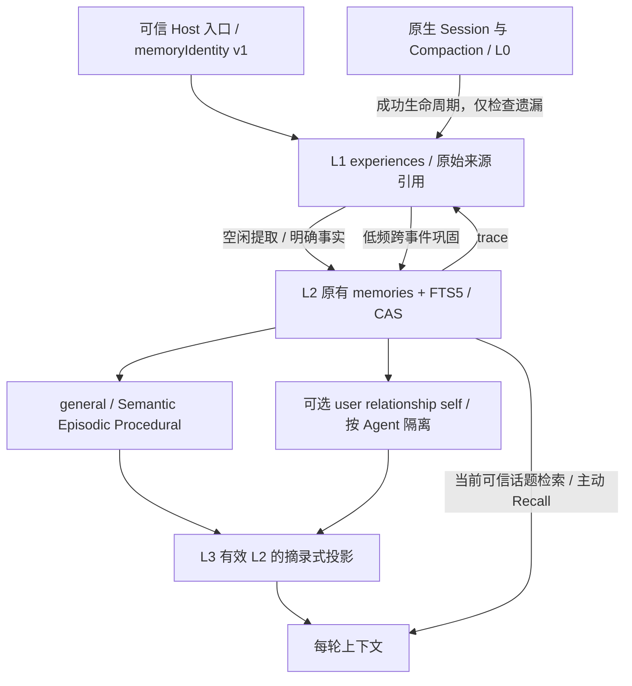

# 分层记忆：test.8

本文件描述当前源码实现及默认配置；实际部署与验证范围见 [交付记录](RELEASE-test8.md) 和 [当前状态](STATUS.md)。仍是原来的四个运行时插件，不增加人格化插件或第二个数据库。某个实例是否启用人格化，应读取该实例 Host 配置和状态工具，而不是根据默认值判断。

## 层次与数据流



“统一 L1”指同一授权三元组 `{principalId, namespaceId, projectId}` 内共用经历表，不是跨用户、角色或项目的全局共享。不同项目默认用不同数据库和三元组。管理员若有意配置相同数据库与三元组，就明确建立了通用 L1/L2 共享边界。

- **L0**：沿用原生 Session、持久化、压缩。没有接管或修改官方实现。
- **L1**：保存 Host 已验证的正文、来源种类、原始 Session/message/event 引用、Agent ID、摘要指纹和状态。相同来源重复到达不重复入库；来源 ID 相同但内容不同拒绝。敏感或注入样式文本拒绝进入记忆。后台入口跳过短于 8 字符及本地确认口令的输入。
- **L2**：沿用原有 `memories`、FTS5、修订、CAS、来源、有效期和遗忘表。种类仍是 Semantic/Episodic/Procedural。Host 可把明确事实直接保存为 L2，并留下 L1/来源；模型工具写入默认 uncertain。已有历史 L2 不被伪造出“原始经历”。
- **跨事件巩固**：至多读取最近 40 条有效 L1 和有限的相关旧 L2，模型提出至多 8 项候选，每项必须有 2–8 个不同事件、逐字引文和至少两份不同正文。已有结论可补充证据；近似重复只在相同主题、种类、极高词项相似度且数字/否定一致时复用。冲突标记双方，排除 L3，留给纠错/确认。
- **L3**：从有效 L2 选择少量可信条目，复制原文并附 ID、revision、用途、置信状态；不调用模型再次改写摘要。未确认的单次推断不进入；多事件支持仍标 `supported`，不是已确认事实。近期将过期（7 天内）或有冲突的条目不进入。预算默认约 1200、上限 1500 个**估算 Token**，含标题和 JSON 元信息，最多 12 条，不截断单条正文。

估算使用独立的 Unicode 启发式（ASCII 约每 3 字符一 Token，非 ASCII 每码点计 2）。它比本机 SDK 的纯字符比例更保守，但不是当前模型的真实 tokenizer，不能保证任意提供方的实际 Token 数严格等于估算。Host 类构造器允许注入 `estimateTokens`，以后可以接模型 tokenizer。

## 可选人格化

`memoryMode` 由可信 Host 返回；模型工具没有 mode、身份、Agent ID 或作用域授权参数。

| 模式 | 通用记忆 | 人格化巩固策略 |
|---|---|---|
| `off`（默认） | 正常提取、巩固、召回与 L3 | 不读取或生成 user / relationship / self |
| `assistant` | 保留 | 工作偏好、协作约定、实际任务反馈；不推断亲密关系或虚构角色经历 |
| `character` | 保留 | 有依据的用户画像、互动约定/共同经历、Agent 实际反馈认知；不改固定 Persona |

人格化 L2 仍在同一个 `memories` 表。Core 通过内部 WeakMap 能力句柄把根作用域映射为保留命名空间 `@layer3:<hash(root, agent, purpose)>`，授权始终回到原 Host 句柄。外部 Provider 不得使用此保留前缀。内部名称只是兼容存储编码，不代表单独的 L3 数据库。三类人格化用途的记忆种类仍然是 semantic / episodic / procedural。

`agentId` 是 Host 配置的稳定逻辑 Agent 标识，不是每次启动变化的 Session UUID。开启人格化必须提供它；Character 默认使用配置的 Preset ID，示例本地 Provider 默认使用 allowedPresetId。不同 Agent 即使共享根 L1，也不能读取彼此人格化 L2/L3；relationship/self 的证据必须属于该 Agent。self 至少要包含一次 Host 核验的真实任务结果，拒绝姓名、年龄、身份等固定设定内容。Off 的旧 Provider 未提供 agentId 时仅使用 Session 级投影缓存，L2 仍可跨会话召回。

切到 Off 是隐藏并停止人格化，不删除已有数据；恢复原模式和 Agent ID 后可以重新使用其仍有效的记忆。固定 Persona 继续由 Definition/构建时 Preset 管理，记忆正文从不成为授权来源。

## 可信入口与消费

契约 v1 保持兼容，`authorize` 可额外返回：

```js
{ principalId, namespaceId, projectId,
  agentId: 'research-assistant', memoryMode: 'assistant', l3Tokens: 1200 }
```

`onEvidence` 继续传 `(issuedHandle, evidence)`。可接受的 L1 来源只有：

- `direct_user`：Host 认证入口收到的真人正文。
- `verified_tool`：Host 确认的真实任务结果；不能仅因为模型说完成，或任意工具输出里写了成功，就设置此来源。

Core 不导入 QQ SDK。现有 Character Provider 继续提供 Owner QQ 原始正文。**本版未把任意工具输出正文自动升级为 verified_tool**。原生 turn/end 会核对最近 400 个事件中的 tool/call 与 tool/result 引用、callId、turn、role、source 和 isError，仅记录工具名、返回状态、计数和事件编号，不保存参数、输出或错误正文，也不把“正常返回”当作目标完成。记忆工具本身不参与这种任务记录，避免形成自我引用循环。其他有语义的任务结果须由可信 Host 适配器验证后发布相同契约。

self 的存储、策略、隔离和上述原生执行元信息入口已实现；从复杂工具输出自动判断任务成败未实现，生产 QQTK/Schedule 到 self 的专用语义桥接未启用。通知账本保持原用途，没有被当成任务成功证据。原生工具配对入口有确定性测试，尚未完成真实模型多轮任务形成 self 认知的端到端验收。

DSH 普通 `user/message` 可能来自插件、摘要或模型决策，不能直接建立真人身份。`session/event` 只处理实际注册 Agent 的同一个 Session 对象，监听 `turn/end` 和无 error 的 `compaction/end`；不读取普通消息或 checkpoint 正文形成 L1。遗漏检查补排已经在可信 L1 中、尚无对应任务/记忆的证据，并在最近 400 个原生事件内补记遗漏的已结束工具调用元信息。无法找回入口插件未捕获的原始 QQ 正文，也不扫描旧私聊历史。

每轮系统上下文调用 `store.context(handle)`：

1. 重新验证并生成当前 Agent 的 L3。
2. 用当前 Session 最新的有效 direct_user L1 作为话题，检索 L2，去掉已在 L3 的重复项。
3. 无可信话题时只加载 L3，不再无差别塞入近期所有 uncertain 记忆。
4. 原有主动 `recall` 保留；需要证据时调用 `trace`。

## 后台节奏与一致性

- 入站轻量记录 L1 与持久提取任务，不阻塞到模型完成。
- 默认空闲 10 秒后开始；每 5 秒检查队列，每批最多 4 个任务，仅使用已授权且当前不在 running 的 Agent。当前 Host 模型执行提取。
- 跨事件巩固默认同作用域/Agent/模式间隔 6 小时；完全相同输入跳过。成功后的输入指纹也记为已处理，避免自己的输出触发下一轮相同整理。
- 同一输入最多 3 次失败尝试；重启把 running 标记恢复为可重试状态。失败记录不保存模型原文或凭据。当前尚无独立的“重置巩固重试次数”Agent 工具。
- 模型请求发出前后重新核对 Host 权限、证据与策略指纹。等待期间发生遗忘、纠错、模式改变或作用域撤销时，不提交旧结果。
- 每个候选用 SQLite savepoint 隔离，保存 L2、来源、证据关联、置信更新和冲突记录同时提交。
- 纠错、遗忘和过期会退休关联旧 L1、清空其正文、取消并清空对应提取任务，清除根作用域所有 L3 缓存。所有关联此证据的 L2 在普通召回/投影中失效，不从旧证据重建。
- 根作用域同时保留退休指纹/来源屏障，遗忘还复用原有近似词项墓碑；不能把已遗忘的 user/relationship/self 内容改存为 general 来绕过屏障。模型仍可看到原 Session 的旧文本，但手动 remember/correct 和巩固都要经过屏障检查。
- 这是保守的“整条经历退休”：同一事件含多个事实时，纠错其中一项可能使同事件其他推断也失效。新的纠正值单独保留，可能需要新的可信证据/确认。它优先防复活，尚未实现句子级证据编辑。

置信值 0.8 是“多事件支持”的排序等级，不是校准概率。引文检查证明候选引用了真实事件，不自动证明归纳逻辑正确；模型仍可能理解错误。原有人工检查、纠错、确认和遗忘用于治理。所有记忆均以参考资料注入，不能改变 Host ACL、审批或固定 Persona。

## 工具与配置

原有九个通用工具及 `character_*` 别名保持；增加 `memory_trace`、`memory_projection`、`memory_layers_status`，Character 入口对应 `character_trace`、`character_projection`、`character_layers_status`。`remember` 仍保存通用 L2，人格化条目由专用后台巩固策略生成；Owner 可用原有 inspect/correct/confirm/forget/merge 管理它们。

```yaml
# Profile config 覆盖会替换整块配置：先复制已安装 Core 的完整 Identity config，
# 保留实际 presetId、bindingFile、stateFile，再设置模式；以下路径只是占位。
- id: character-identity
  config:
    presetId: qq-character
    bindingFile: '<ABSOLUTE_PROJECT_DATA>/binding.json'
    stateFile: '<ABSOLUTE_PROJECT_DATA>/coordination.sqlite'
    memoryMode: character  # off / assistant / character
    memoryAgentId: qq-character  # 保留既有稳定 ID；更改会切换人格化投影作用域
    l3Tokens: 1200
- id: character-memory-core
  config:
    database: '<ABSOLUTE_PROJECT_DATA>/memory.sqlite'
    autoCapture: true
    consolidation: true
    idleMs: 10000
    consolidateIntervalMs: 21600000
    extractTimeoutMs: 45000
```

普通 Host 示例用 `agentId`，Character Provider 用 `memoryAgentId`，均返回契约中的 `agentId`。`autoCapture: false` 停止自动 L1、提取和巩固；工具与读取仍可用。`consolidation: false` 只停跨事件巩固。模式/权限是 Host 配置，修改后应按正常插件生命周期重载；不要让模型直接改授权字段。

## Schema 3 与迁移、回滚

保留原表，新增 `experiences`、`memory_evidence`、`memory_lanes`、`core_projections`、`consolidation_runs`、`memory_checkpoints`。旧 L2、修订、来源、FTS 和遗忘记录原位保留；旧持久队列仅在处理真实存量证据时补充 L1，不给历史 L2编造来源。迁移事务失败回滚。

首次用 test.8 打开数据库会迁移。**不能只把插件退回 test.7：旧版本拒绝 Schema 3。** 推荐先用副本验证：

```sh
node scripts/migrate-memory.mjs /backup/memory-v2.sqlite /staging/memory-v3.sqlite
```

此脚本以只读连接打开来源，用 SQLite backup API 生成一致副本，仅迁移新目标，拒绝覆盖，校验完整性和记忆条数。Windows 同样使用两个绝对路径。脚本不修改 Profile 或激活生产。

未来获准上线时：等待空闲、停止写入、保存原数据库及一致性备份/原 Profile 和固定包版本；在新目标完成迁移和隔离回归后单活切换。回滚时停止新版，恢复旧包/配置和**迁移前数据库副本**；不能把旧版直接指向 Schema 3。切换后新产生的数据不会自动合并回旧库，需要另行审计；禁止以删除版本标记方式伪装降级。

当前没有生产迁移或生产回滚操作。隔离验证覆盖 Schema 2 副本迁移、原文件字节不变、旧库可重新打开，以及 Schema 3 重启恢复。

## 明确限制

未实现向量检索、全量历史回扫、独立 UI、新 Worker、主动聊天或 Skills 生成。跨事件窗口目前是最近 40 条有效经历，不保证跨多年全库聚类；原有 L2 的中文 FTS5 召回仍保留。没有全局多进程写入/后台调度租约，同一数据库应只由一个 Host Core 实例管理。模型质量、长时间压力及真实 QQ 新模式验收不由单元测试代替。
